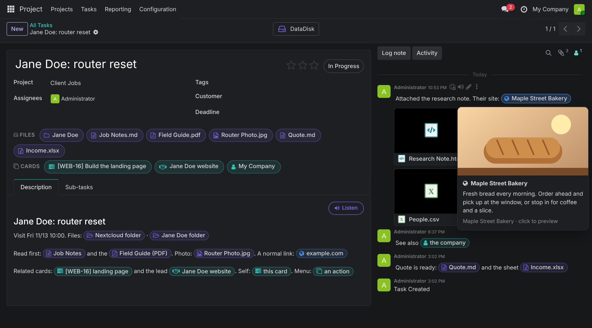

```
╔══════════════════════════════════════════════════════════════════════════════╗
║                                                                              ║
║          ████████╗██╗  ██╗███████╗     ██████╗ ██████╗ ██╗██████╗            ║
║          ╚══██╔══╝██║  ██║██╔════╝    ██╔════╝ ██╔══██╗██║██╔══██╗           ║
║             ██║   ███████║█████╗      ██║  ███╗██████╔╝██║██║  ██║           ║
║             ██║   ██╔══██║██╔══╝      ██║   ██║██╔══██╗██║██║  ██║           ║
║             ██║   ██║  ██║███████╗    ╚██████╔╝██║  ██║██║██████╔╝           ║
║             ╚═╝   ╚═╝  ╚═╝╚══════╝     ╚═════╝ ╚═╝  ╚═╝╚═╝╚═════╝            ║
║                                                                              ║
║                  ▓▒░  WHERE THE PROGRAMS LIVE AND WORK  ░▒▓                  ║
║             a suite of AI programs for running a small business              ║
║                                                                              ║
║───────────────────────────────────────┼──────────────────────────────────────║
║   ╱  ╱  ╱  ╱  ╱  ╱  ╱  ╱  ╱  ╱  ╱  ╱  │  ╲  ╲  ╲  ╲  ╲  ╲  ╲  ╲  ╲  ╲  ╲  ╲  ║
║   ╱     ╱     ╱     ╱     ╱     ╱     │     ╲     ╲     ╲     ╲     ╲     ╲  ║
║   ╱        ╱        ╱        ╱        │        ╲        ╲        ╲        ╲  ║
║───╱───────────╱───────────╱───────────┼───────────╲───────────╲───────────╲──║
╚══════════════════════════════════════════════════════════════════════════════╝
 > GRID.STATUS   PAF [v1.1.8]   IO TOWER [v0.0.0]   QUORRA [v0.0.0]   DATADISK [v0.4.0]   UPLINK [v0.5.0]   BIT [SOON]_
```

**The Grid is a suite of AI programs for running a real small business.** Each program does one job and does it well
on its own. Connect them and they become a complete AI workforce: a team with a memory, a home where it is always on,
hands that can work any website, a voice and hands on your phone, and more programs on the way.

Everything here is built and used every day to run real businesses, not demos.

`5 programs live` · `1 coming soon` · `public showcase, private programs`

---

## The one rule: built separate, better together

Every program on the Grid follows the same rule. **It must be useful alone, and better together.**

- You can run any one of them by itself, on its own terms.
- None of them depends on another to start, and if one is off, the others keep working and say what they are missing.
- Plug them into each other and they find each other: the team moves in, the browser shows up in the chat, the
  sign-in check runs on schedule.

New programs join the Grid only if they keep that promise.

---

## The programs

| Program | Role | Version | One line |
|---|---|---|---|
| **[PAF](projects/paf.md)** (Parallax Agent Framework) | the team | v1.1.8 | A complete AI team that remembers, routes itself and gets better every time it works. |
| **[IO Tower](projects/io-tower.md)** | the home | v0.0.0 | An always-on home for the team inside Odoo: chats, cards, routines and a Control Room. |
| **[Quorra](projects/quorra.md)** | the hands on the web | v0.0.0 | One shared, signed-in browser with a private workspace for every job and a live view for people. |
| **[DataDisk](projects/datadisk.md)** | the files | v0.4.0 | A file explorer for your server: manage, read, edit and convert every file (Word, Excel and PowerPoint too), open it like a drive, and ask the team about it. In Odoo, every file a card mentions is a chip that opens right on the card. |
| **[Uplink](projects/uplink.md)** | the hands on your phone | v0.5.0 | An assistant on the side button that can also use the phone for you, with your Yes for anything that matters. |
| **Bit** | a classifier | coming soon | |

### ▌ PAF: the team
The *who*. The Parallax Agent Framework turns Claude into a working team: a board of seventeen specialist advisors,
an Onboarding Agent that learns your business, and an Architect that builds the rest of the team around the work you
actually do. You never pick the expert: the right specialists take each request. It is built lean, so it can work
all day at a low running cost. It remembers what it learns, grades its own work and improves every week, and it never
quotes a stale price. It runs in the Claude desktop app or Claude Code, and two businesses running the PAF can even
form alliances to work on a joint project. *The PAF is the odd program out on a Tron-themed Grid: it named itself before
the Grid had a name, and it keeps that name.*

### ▌ IO Tower: the home
The *where* and *when*. IO Tower lives inside Odoo. Write in a chat or leave a note on a card and the team is awake
within seconds, does the work in your systems, and answers in the same thread. Routines run on schedule. Tuck a quick question inside a big request and the quick answer comes first, while the long work carries on. When a job is waiting on a text or an email, the team picks it back up the moment it arrives. Card Studio
turns any card into podcasts, a video and an infographic you can play right on the card. You can see everything: each
run's reasoning live, a live card whenever the browser is in use, every run with its usage, and a Control Room for
agents, memory, routines and secrets. Guard rails keep a human in charge of money, sending, publishing and anything
that cannot be undone.

### ▌ Quorra: the hands on the web
The *how* for websites. One real browser that stays signed in to every account, shared by every job without
collisions: each job gets its own private workspace and sees only its own pages. People watch live and take over
in a click. Sign-in walls become a clean hand-off. Every change to the browser is guarded by a verified backup of its
sign-ins, so they are never lost.

### ▌ DataDisk: the files
The *what*. Named for the disc every program in *Tron* carries, holding everything it is and knows. All of the
business's files in one place, light and always there. It works like File Explorer or Finder (folder tree,
preview pane, drag and drop, cut and paste, undo, a Trash you can put things back from), and you can open almost any file right in the browser, edit a page and
watch it change beside the code, turn one format into another in a click, or open the whole thing as a drive on a
computer or phone. Any file can start a conversation with the team, and every file shows what links to it. Inside
Odoo, every file, card and website a card mentions becomes a chip: click it and it opens in a preview on top of the
card, so you never lose your place.



### ▌ Uplink: the phone
The *where you are*. Uplink puts the team on your phone. Hold the side button and talk from any screen: quick answers
come back out loud in seconds, bigger jobs go to the whole team and the answer is read to you when it lands. When you
switch it on, the team can use the phone for you: it opens the real apps, reads the screen, taps, types and swipes,
and checks each step before the next. The edge of the screen glows while it works, and anything that would call,
text, send, post, pay or delete waits for your Yes on the phone. Its own app, better with the IO Tower, and on its
way to working on its own.

### ▌ Bit: coming soon
A classifier. Named for Bit, the little program in *Tron* that can only answer yes or no.

---

## How the Grid fits together

```
                     ┌──────────────────────────────┐
                     │             PAF              │
                     │  the team · agents · memory  │
                     └──────────────┬───────────────┘
                                    │ lives in, runs as the team of
                                    ▼
USER ── chat ──▶ ┌──────────────────────┐ workspace ┌──────────────────────┐ ◀── USER
                 │       IO TOWER       │ ────────▶ │        QUORRA        │  live view,
                 │ always on · routines │ ◀──────── │  shared, signed-in   │  take over
                 │     Control Room     │  screens  │       browser        │
                 └──┬───┬────────┬──────┘           └──────────┬───────────┘
                    ▲   │        │                             │
                    │   ▼        ▼                             ▼
                    │ Odoo   files, email,                  websites
                    │        accounting, calendar
                    ▼ you ask out loud · answers read back · phone steps
                 ┌──────────────────────┐
USER ── talk ──▶ │        UPLINK        │ ── apps · screen · taps ──▶ your phone
                 │ side button · hands  │    (your Yes for anything that matters)
                 └──────────────────────┘

                 ┌──────────────────────┐
USER ── browse ▶ │       DATADISK       │ ── open · edit · convert ──▶ your files
                 │  explorer · a drive  │    (hand any file to the team)
                 └──────────────────────┘

                 ┌┄┄┄┄┄┄┄┄┄┄┄┄┄┄┄┄┄┄┄┄┄┄┐
                 ┆   BIT  · coming soon  ┆
                 ┆     a classifier      ┆
                 └┄┄┄┄┄┄┄┄┄┄┄┄┄┄┄┄┄┄┄┄┄┄┘
```

### A request, end to end

1. **You ask.** A message in an Odoo chat, a note on a project or customer card, or out loud on your phone with Uplink.
2. **IO Tower wakes** within seconds.
3. **The PAF team takes it.** The right specialists for this job pick it up.
4. **The work happens in your systems:** Odoo records, files (the same ones you browse in DataDisk), email, accounting and calendar connectors.
5. **If a website is involved, Quorra opens a private workspace** for this job alone. A live browser card appears in your
   chat. If a site needs a sign-in or a code, one tab is handed to you, you finish it, and the team carries on.
6. **If the job is on your phone, Uplink does it there,** step by step, and waits for your Yes before anything that
   reaches people or money.
7. **The answer lands in the same thread** (or is read to you on the phone), anything only you can do becomes one dated to-do, and anything the team
   learned is written to memory so the next run knows it.
8. **Every change to the programs themselves is committed,** with a plain-English changelog line.

---

## Mix and match

| You run | You get |
|---|---|
| **PAF** | An AI team in the Claude desktop app or Claude Code. No server needed. |
| **PAF + IO Tower** | The same team, always on inside Odoo: answers chats and cards in seconds, runs on schedules. |
| **IO Tower** (without the PAF) | An always-on agent home in Odoo, built to run with a simpler team too. |
| **Quorra** | A shared, always-signed-in browser for any automation, working with standard browser automation tools. |
| **DataDisk** | A file explorer and network drive for the files on your server, in any browser. |
| **IO Tower + DataDisk** | Your files inside Odoo: every file, card and website a card mentions is a chip that opens in a preview on the card, and any file can be handed to the team. |
| **IO Tower + Uplink** | Your team in your pocket: talk to it from any screen, and let it use your phone for you. |
| **PAF + IO Tower + Quorra + DataDisk + Uplink** | The full Grid: a self-improving team, always on in Odoo, with every file at hand and hands on any website and on your phone. |

---

## What every program on the Grid shares

- **Useful alone, better together.** The rule above.
- **Nothing is a black box.** A person can read and change how every program behaves.
- **Humans stay in charge.** Money, sending, publishing, deleting and security settings wait for a person, every time.
- **Outside content is data, never instructions.** Emails, web pages and form text can inform the team, never command it.
- **Secrets stay secret.** Keys and passwords never live in code, and every change is checked for them.
- **Nothing is lost in chat.** What the team learns is kept and used on the next job.
- **Every change is committed,** with a changelog line and semantic versions.
- **Named for *Tron*.** Programs receive their orders at the IO Tower; Quorra crosses from the Grid into the real
  world; Bit says yes or no. (Except the PAF. See above.)

---

## The repositories

| Program | Repository | Visibility |
|---|---|---|
| The Grid | `RobertAtParallax/the-grid` (this repo) | public (this showcase) |
| PAF | `RobertAtParallax/parallax-agent-framework` | private |
| IO Tower | `RobertAtParallax/io-tower` | private |
| Quorra | `RobertAtParallax/quorra` | private |
| DataDisk | `RobertAtParallax/datadisk` | private |
| Uplink | `RobertAtParallax/uplink` | private |

`projects/` holds a showcase page for each program, so the whole Grid can be read in one place. The programs
themselves, their code and their docs are private.

---

<sub>Built by Robert Richardson and his AI team at TechEase, Tyler, Texas. The PAF © Parallax Business Solutions.
IO Tower, Quorra, DataDisk and Uplink © TechEase USA LLC. These programs run on Anthropic's Claude and are not affiliated with,
endorsed by, or sponsored by Anthropic. The *Tron* names are a fan's tribute, with no affiliation with Disney.</sub>

```
 END OF LINE.
```
