> Showcase page for **DataDisk**, one of the programs on [The Grid](../README.md). The program itself is private.

```
╔══════════════════════════════════════════════════════════════════════════════╗
║                                                                              ║
║         ██████╗  █████╗ ████████╗ █████╗ ██████╗ ██╗███████╗██╗  ██╗         ║
║         ██╔══██╗██╔══██╗╚══██╔══╝██╔══██╗██╔══██╗██║██╔════╝██║ ██╔╝         ║
║         ██║  ██║███████║   ██║   ███████║██║  ██║██║███████╗█████╔╝          ║
║         ██║  ██║██╔══██║   ██║   ██╔══██║██║  ██║██║╚════██║██╔═██╗          ║
║         ██████╔╝██║  ██║   ██║   ██║  ██║██████╔╝██║███████║██║  ██╗         ║
║         ╚═════╝ ╚═╝  ╚═╝   ╚═╝   ╚═╝  ╚═╝╚═════╝ ╚═╝╚══════╝╚═╝  ╚═╝         ║
║                                                                              ║
║        ▓▒░  EVERYTHING YOU DO OR LEARN IS IMPRINTED ON THE DISK  ░▒▓         ║
║             a file manager for the files already on your server              ║
║                                                                              ║
╚══════════════════════════════════════════════════════════════════════════════╝
 > SYS.BOOT   explorer [ONLINE]   viewer [ONLINE]   editor [ONLINE]   chips [LINKED]   v0.5.0_
```

# DataDisk

**DataDisk is a file manager for the files already on your server.** Open it in a browser or as an app inside Odoo
and every folder looks and works like File Explorer or Finder. Browse, preview, edit, convert and move your files,
hand any of them to the team, and open the whole thing as a drive on your computer or phone. Inside Odoo, every file
a card mentions is one click away, without leaving the card.

`v0.5.0` · any browser, or as an app in Odoo · Windows, Mac, Android and iPhone as a network drive

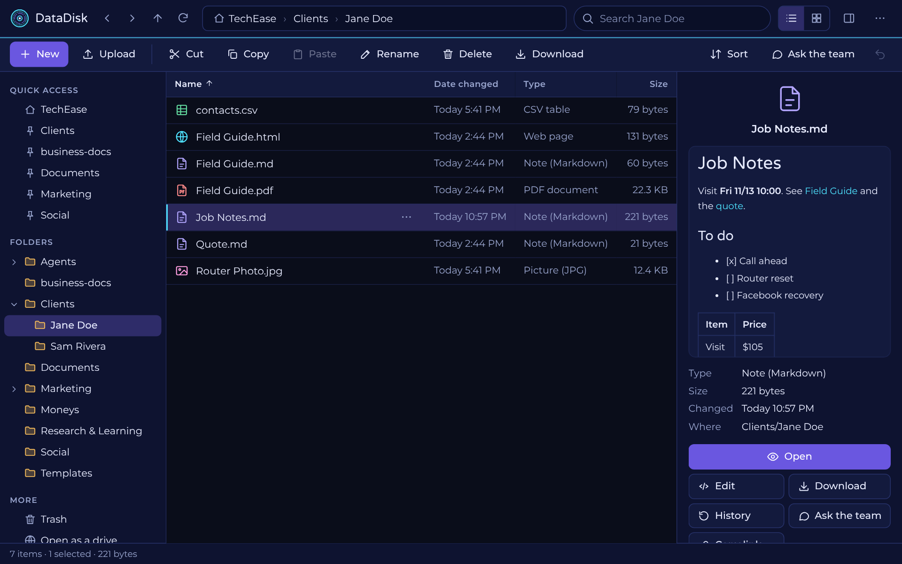

---

**Light and Dark** (and OLED, NeonWave, or follow your device):

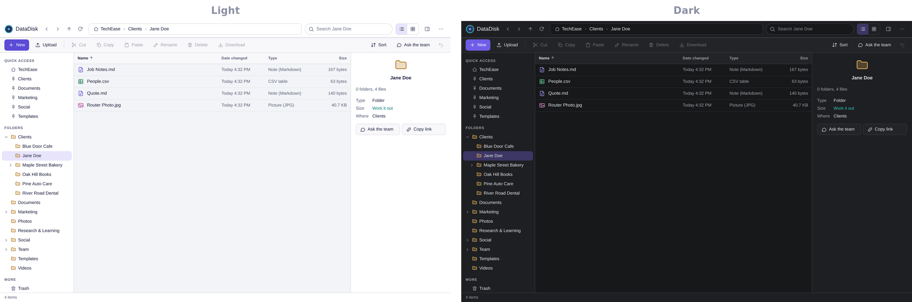

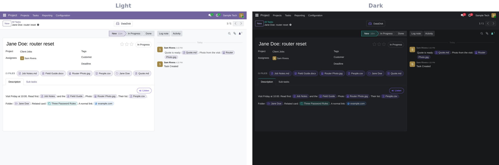

## What you get

**▌ A real file explorer**
- **Feels like your computer:** a folder tree, Quick access you can pin folders to, a details or icons view with
  thumbnails, and a preview pane.
- **Select like on a computer:** click, Ctrl-click, Shift-click, drag a box, Ctrl+A, and right-click for everything.
- **Fast:** moving between folders is instant, and back and forward still work.
- **Made for phones too:** tap to open, a menu button on every row, and big targets.
- **Wears your theme:** light, dark, true black, a neon look, or whatever your device is set to. Inside Odoo it
  matches Odoo and changes with it.

**▌ Manage every file**
- **Drag and drop** to move, hold Ctrl to copy. Cut, copy, paste and rename in place.
- **Make a copy, Move to, Copy to** with a folder picker.
- **Upload** files or whole folders by dragging them in. **Download** a folder as one .zip.
- **Undo** a move, copy, rename or delete.
- **Search** the folder as you type, or everything at once, names and inside notes.

**▌ Open almost anything, without losing your place**
- Notes, web pages, PDFs, pictures, video, audio, spreadsheets, Word files and code open **on top of the folder**,
  with Previous and Next to walk through it.
- **Tools that fit the file:** zoom, turn and flip a picture; filter and sort a table; jump to a heading in a note;
  wrap and copy code; print; full screen.
- **PDFs work on a phone,** shown page by page.
- **Word, Excel and PowerPoint, edited right there:** they open in a full office editor in the same preview,
  on a card too. Press Save and the copy before is kept in History.

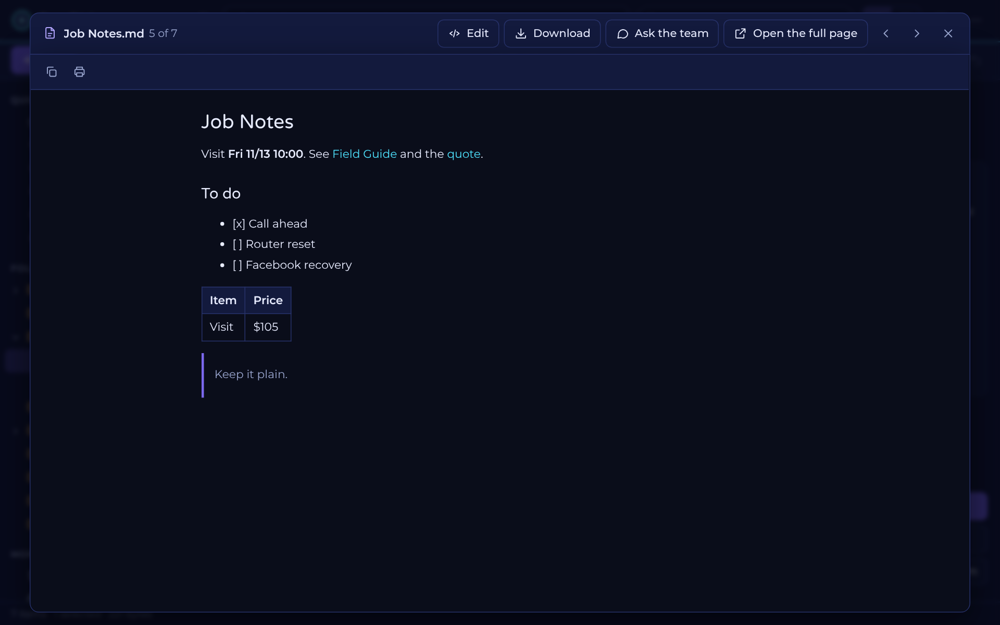

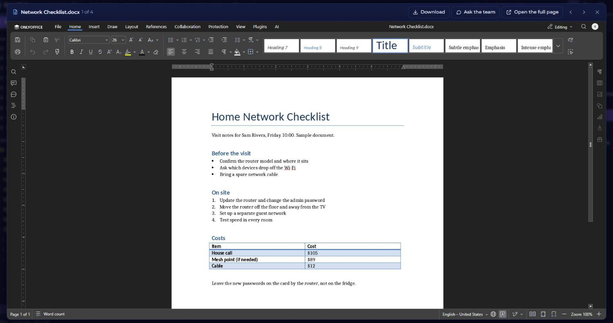

**▌ Write and edit**
- **Notes with a toolbar:** bold, headings, lists, to-do lists, links, tables and pictures (paste or drop one in),
  with the finished page beside the text as you type.
- **Find and replace,** a word count, and **Save as I type.**
- **Tables as a grid:** a .csv file opens like a small spreadsheet you type into.
- **Run Python:** press Run and see what the code prints, right beside it. It runs safely in your browser.
- **New** note, text file, table or web page in two clicks.

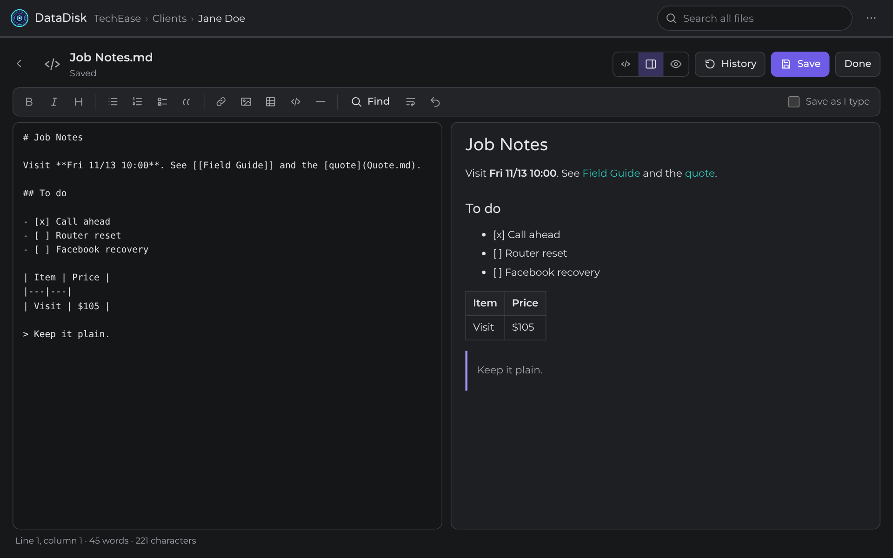

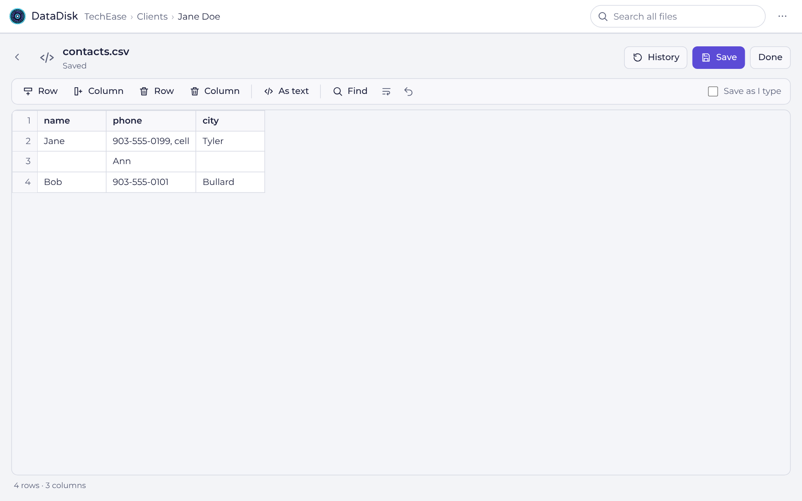

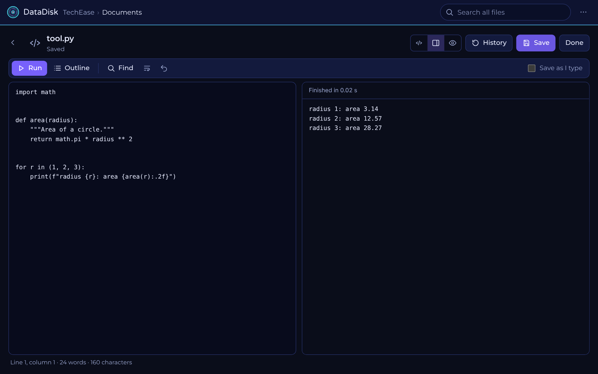

**▌ Convert in one click**
- Notes to a branded PDF or Word file, web pages and Word files to PDF, pictures, video, audio and spreadsheets
  from one format to another.

**▌ Your files as a drive**
- Connect it as a network drive on Windows or a Mac, or with a file app on your phone. Edits land straight on the server.
- On a Windows PC it can be a regular mapped drive: fast, shows your real disk space, and deleted files go to a recycle folder first.

**▌ Works with your AI team**
- **Ask the team** about any file and a conversation about it opens with the right people.
- **Every file shows what links to it.**

**▌ Chips: everything a card mentions, one click away (inside Odoo)**
- **Files are chips.** Every file and folder a task or a customer mentions shows as a chip on the card. Click it
  and the file opens in a preview on top of the card. You never leave the card.
- **Cards are chips.** A link to another task or customer opens that card in a pop-up you can read, change and save.
  Its conversation comes with it: beside the card on a wide screen, one tap away on a phone, so you can read and
  reply without opening the card in full.
- **Websites are chips.** A web link opens the whole page in a pop-up, even on sites that normally refuse to be
  shown inside another page, and the links you click stay in the pop-up. Rest the pointer on a chip for a picture
  and a summary.
- **Attachments open properly.** A web page, Word file, table or video attached to a card opens in the same preview.
- **Three colors** tell files, cards and websites apart at a glance.
- **Cards that get to the point.** A task's header fields fold away behind one line, so the description comes
  first. Tags stay in view.

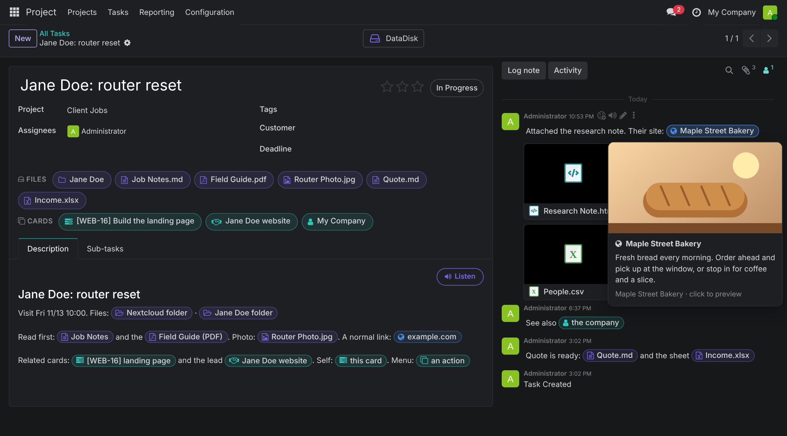

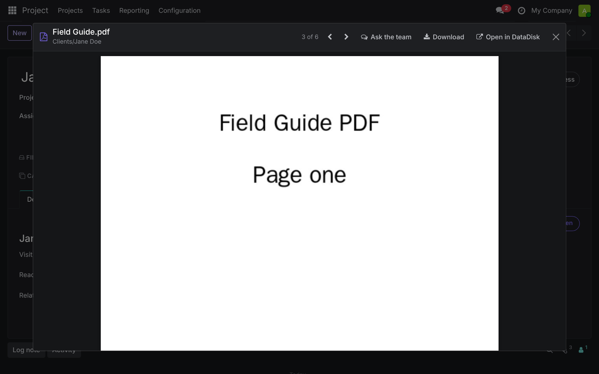

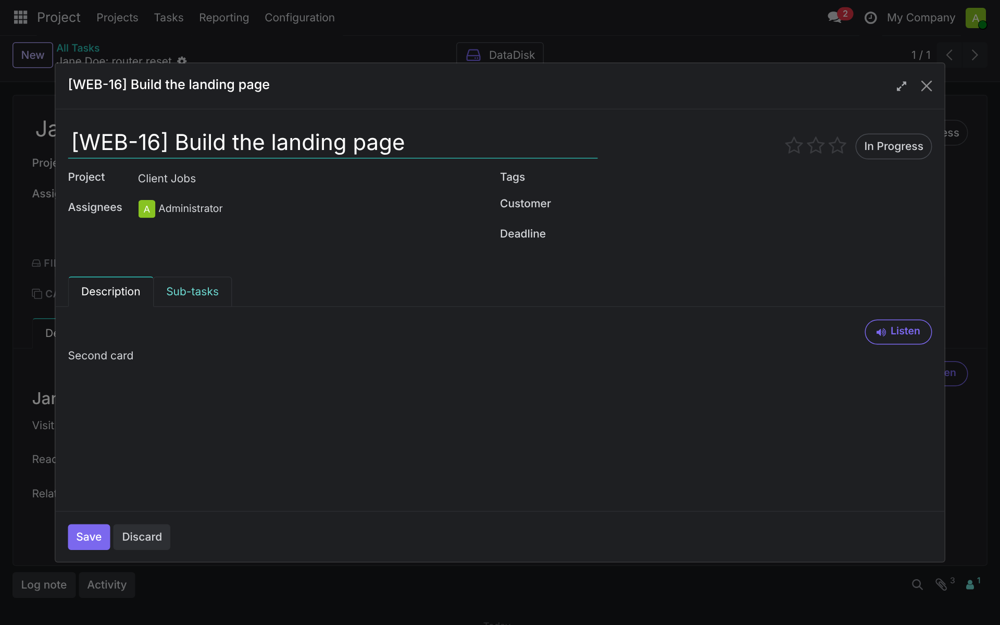

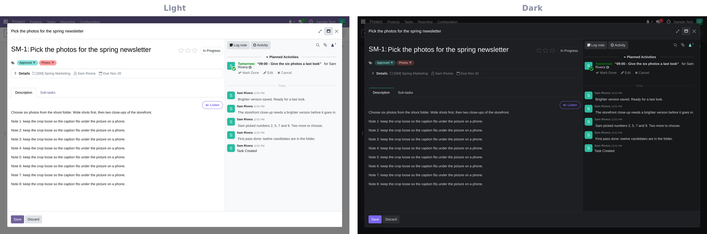

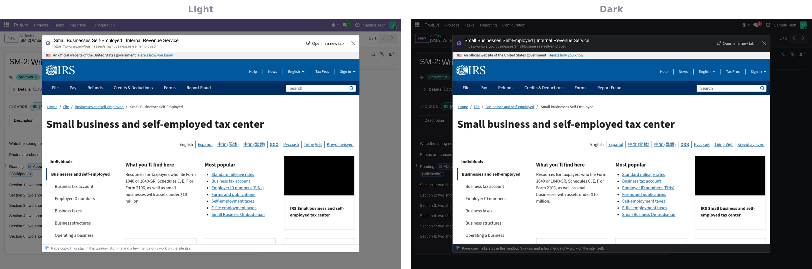

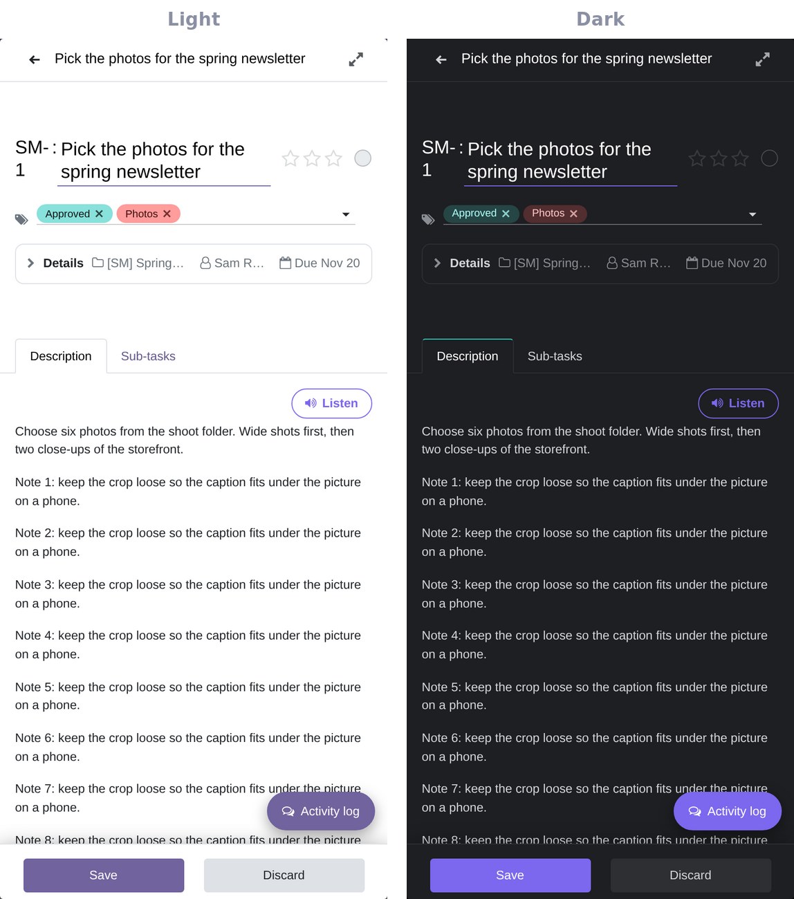

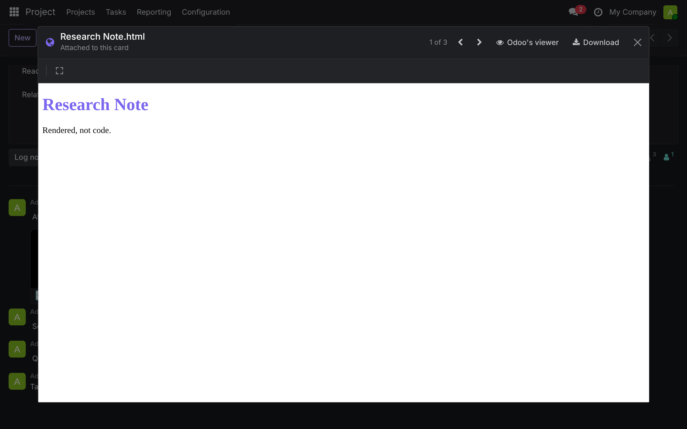

**▌ Nothing is lost**
- **History:** every save keeps the copy before it. Read an older copy, download it, or bring it back.
- **Delete means Trash,** kept 30 days and put back in one click.
- **Secrets never show,** and the folders the team runs on ask twice before they move.
- **Private:** only you, on your own private network.

---

## Built separate, better together

On its own, DataDisk is a light file manager and network drive for your server. With the IO Tower it lives inside
Odoo, turns every file, card and website a card mentions into a chip, and lets you hand any file to the team. With
the PAF, the team's own notes and memory become a folder you can read and edit like any other.

---

<sub>Part of [The Grid](../README.md): built separate, better together. Screenshots use sample data.</sub>

```
 END OF LINE.
```
