> Showcase page for the **IO Tower**, one of the programs on [The Grid](../README.md). The program itself is private.

```
╔══════════════════════════════════════════════════════════════════════════════╗
║                                                                              ║
║         ██╗ ██████╗     ████████╗ ██████╗ ██╗    ██╗███████╗██████╗          ║
║         ██║██╔═══██╗    ╚══██╔══╝██╔═══██╗██║    ██║██╔════╝██╔══██╗         ║
║         ██║██║   ██║       ██║   ██║   ██║██║ █╗ ██║█████╗  ██████╔╝         ║
║         ██║██║   ██║       ██║   ██║   ██║██║███╗██║██╔══╝  ██╔══██╗         ║
║         ██║╚██████╔╝       ██║   ╚██████╔╝╚███╔███╔╝███████╗██║  ██║         ║
║         ╚═╝ ╚═════╝        ╚═╝    ╚═════╝  ╚══╝╚══╝ ╚══════╝╚═╝  ╚═╝         ║
║                                                                              ║
║             ▓▒░  PROGRAMS RECEIVE THEIR ORDERS AT THE TOWER  ░▒▓             ║
║                      an AI team that lives inside Odoo                       ║
║                                                                              ║
╚══════════════════════════════════════════════════════════════════════════════╝
 > SYS.BOOT   listener [ONLINE]   routines [ARMED]   agents [READY]   v0.0.0_
```

# IO Tower

**IO Tower turns Odoo into the place where you and an AI team work side by side.** Write in a chat or leave a note on
a project card, and within seconds a team of specialist agents picks it up, does the work in your systems, and
answers right there in the thread. No new app to learn: the team lives where your business already runs.

`v0.0.0` · Odoo 19 Community · Claude

---

## What you get

**▌ Talk to your team where you already work**
- **Answers in seconds.** The team is always on: no timers, no inbox to check.
- **Works everywhere in Odoo:** chats, department threads and any project, customer or task card.
- **Many jobs at once.** Up to five conversations in parallel, with card jobs and scheduled routines running alongside.
- **Feels like a colleague.** "Team is typing..." while it works, and a 👀 on your note that turns ✅ when it's done.
- **Pick up where you left off.** Reply to a message and the team continues that exact conversation.
- **Every link is clickable.** Web addresses and file mentions in the team's notes open with one click.
- **Quick answers first.** Tuck a small question inside a big request and the small answer comes straight back,
  while the long work carries on.
- **Talk out loud, hear it back.** A voice page on your phone or computer: say what you need, and the answer is
  spoken in a natural voice made on your own server, so your words never go to a big tech company.

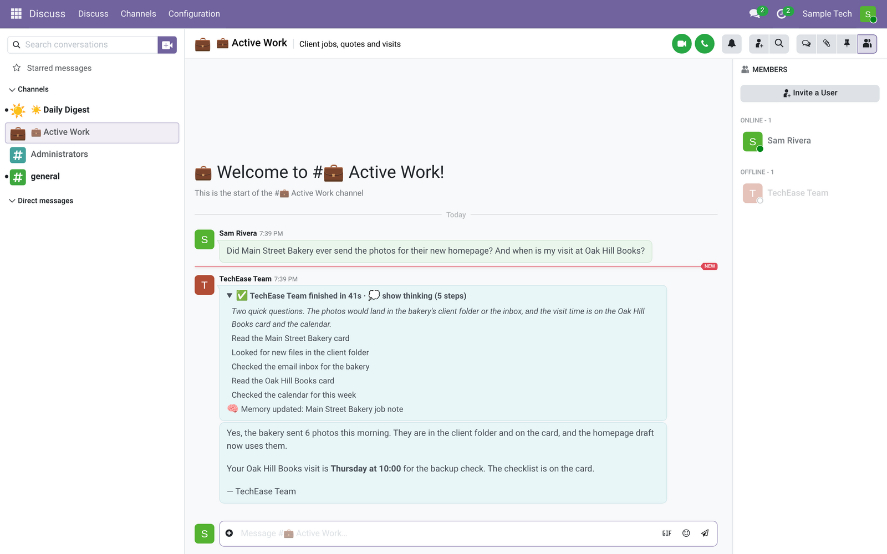
- **It waits without watching the clock.** When a job is waiting on a customer's text or email, a file, a date,
  an invoice getting paid, a TikTok or Instagram message, or a signal from another system, the team picks it back up
  the moment it arrives.

**▌ Agents that act, not just answer**
- **A team of specialists** (sales, operations, web, finance, security, writing and more), with the right ones
  chosen for each job, and extra hands brought in when work can run in parallel.
- **Works in your real systems:** Odoo records, files, email, accounting and calendar, and any website through Quorra.
- **Keeps your pipeline honest:** moves cards to the right stage, files follow-ups as dated to-dos, and prepares
  outgoing email on the card for a one-word "send it".
- **Choose how hard the team thinks, card by card.** Every card has its own I/O Tower tab: pick the model and
  strength for that card, or switch on **Deep research** for a careful, cited report.

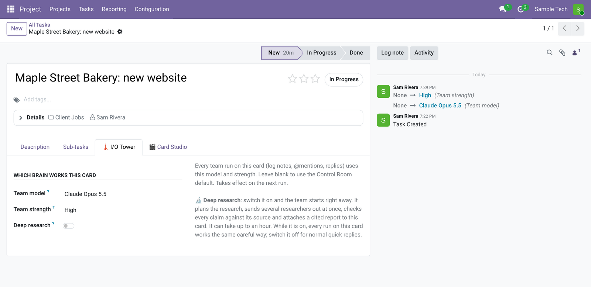

**▌ See everything**
- **Live thinking.** Watch the team's reasoning and every step as it works.
- **A live browser card** in the chat whenever the team is on a website, with a fresh screenshot and buttons to open
  the browser, take control or stop the job.
- **See it from your calendar too.** While the team works on something that is on your calendar, that item shows
  one small line under its title: what the team is doing right now, how long it has been at it and who is on it.
  The line goes away by itself when the work is done.

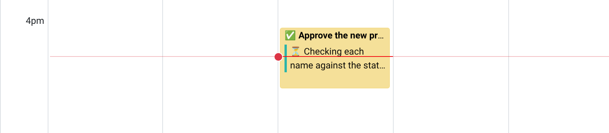

- **The team's own agenda on your calendar.** What the team is waiting for (a reply, a file, a date) and when it will
  check again, plus every routine it will run, sit on your calendar next to your own day. One tick box hides or
  shows them, and a **🤖 Team Agenda** list shows them all in order.

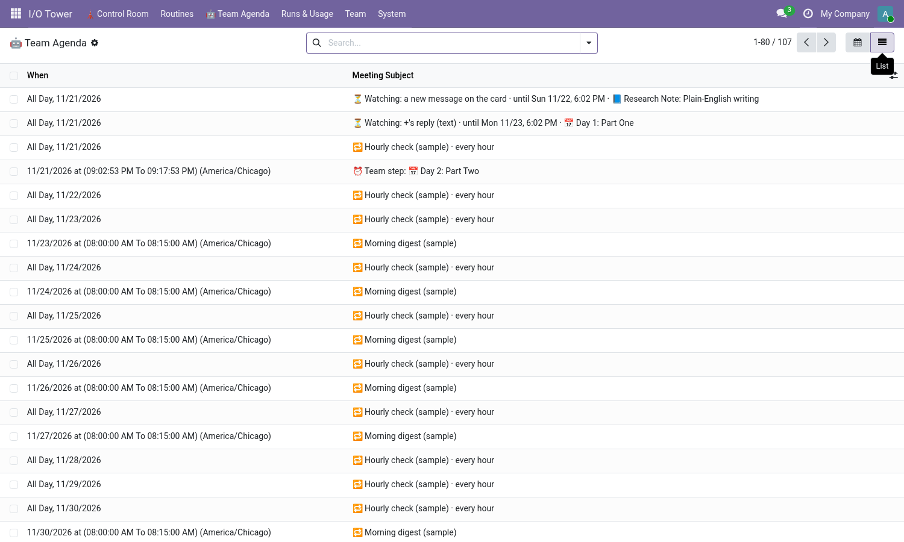

- **Every run on the record,** with time, model and usage, plus quota watching so nothing runs dry by surprise.

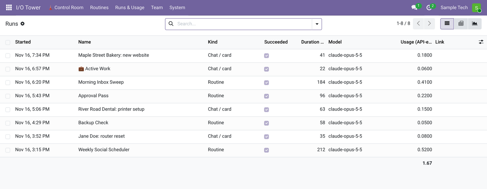

- **A morning digest in every chat that has something due:** overdue, today and the next three days, led by the one
  thing that matters most. A quiet chat gets nothing, so no empty notifications.

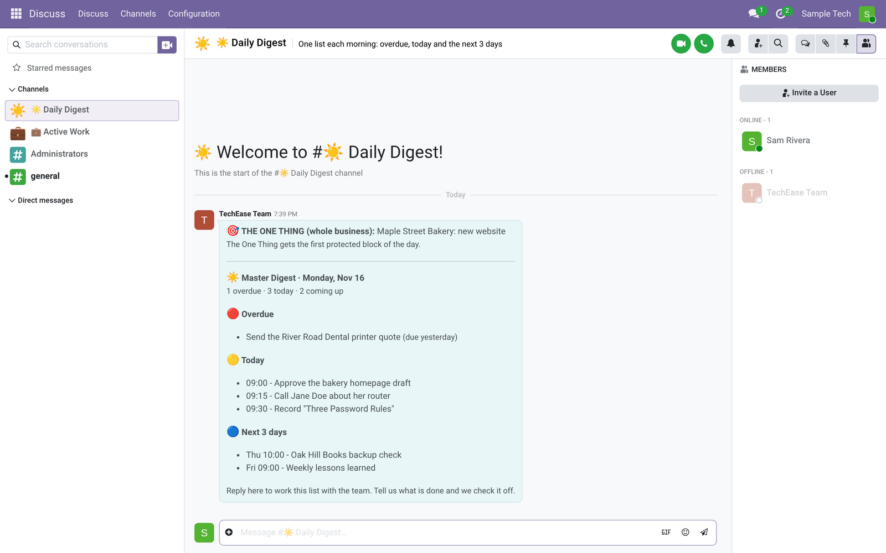

**▌ 🎬 Card Studio: listen to any card**
- **One button, four pieces.** Any project or customer card becomes a long deep dive podcast, a quick podcast with
  the main idea, a short learning video and a one-page infographic.
- **Everything on the card counts:** the notes, the history and the files on it, research papers included.
- **Press play right on the card.** Each card gets its own Card Studio tab where the podcasts and the video play and
  the infographic shows, however long the card's history gets. Every piece is saved with your files too.

**▌ 📚 Learning Library: everything you have learned, on one shelf**
- **Every research card on three shelves:** what you learned, what you are learning now and what is up next. A new
  research card shows up by itself, with nothing to copy.
- **Tap a card to read it big:** the whole write-up, its files and its day-by-day notes, then back to the shelf.
- **Find anything fast:** one search box looks at every word on every card, with topic chips and a sort. Works on a
  phone, in Light and Dark.

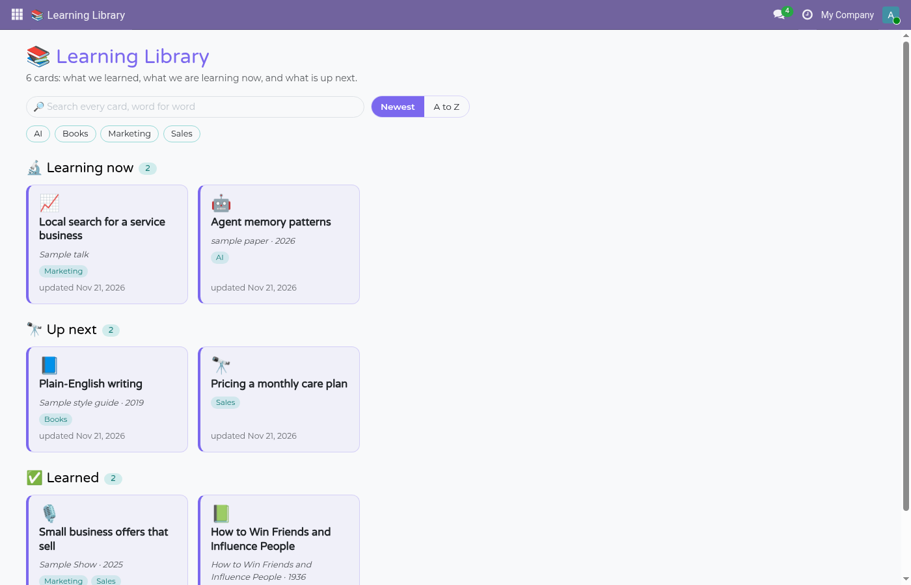
- **Drill down from any card:** an open card shows the cards inside it and the rest of its series on a small shelf of
  their own, with "You are here" on the one you are reading. Tap one to go deeper, Back to come up again.

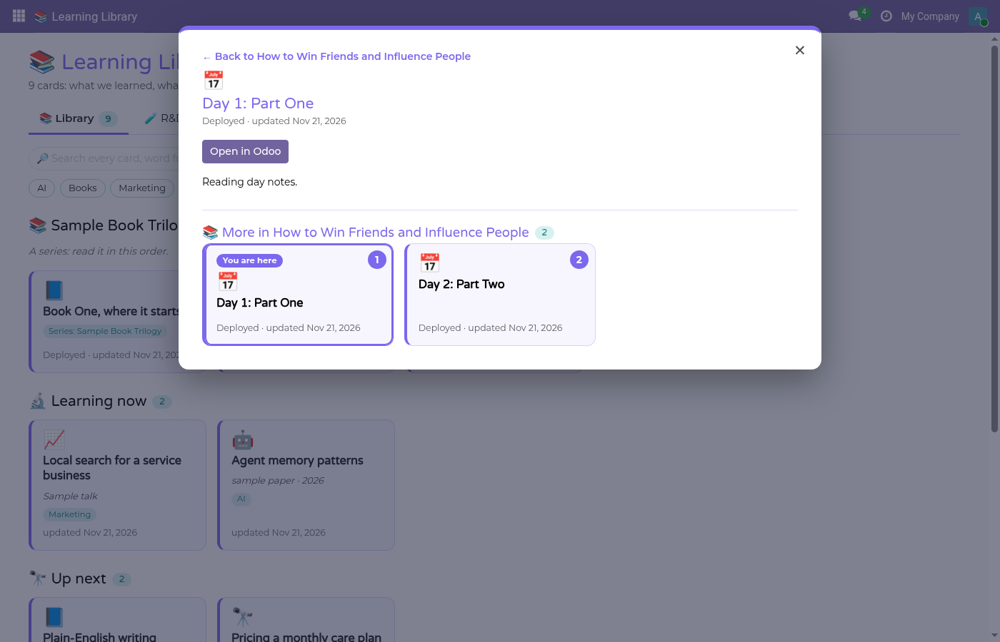
- **Listen, watch and look right on the card:** a card's podcasts play at the top, its videos and infographics sit
  just under its own cards, and the card face shows a small mark when it has them. Sources, links and files show as
  chips, one look per kind, so a book, a paper, a video and another card read differently at a glance.

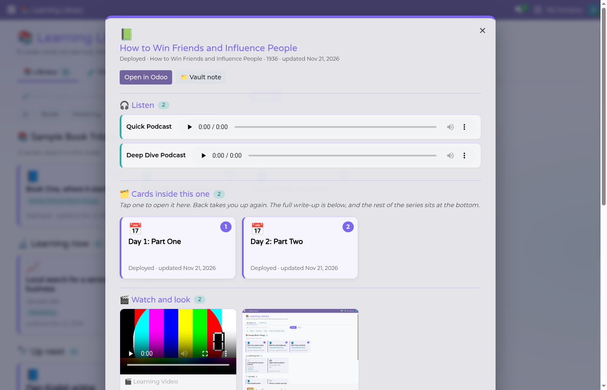
- **🔒 A private library for every person:** each person gets a My Library tab of their own, with the same shelves
  and reader. Only they can see it. A card goes public only when its owner taps Make public, and it stays the same
  card.

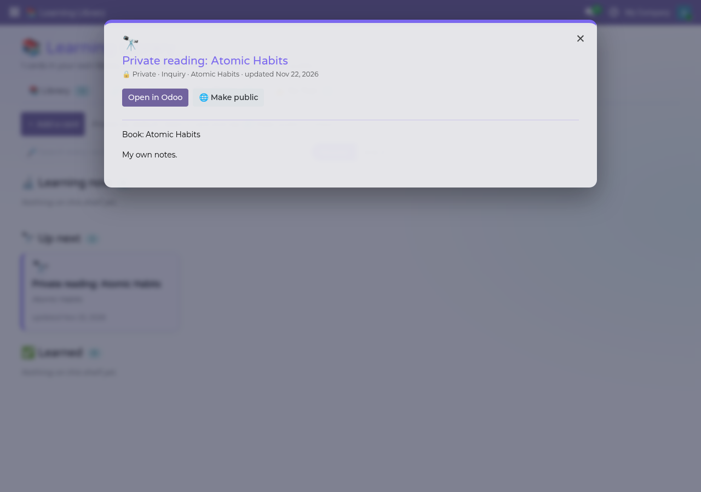

**▌ 🔊 Listen to any message**
- Press play on any message, on any card or chat, and hear it read in a natural voice made on your own server.
  Skip back or ahead 5 seconds, pause, change the speed or pick another voice.

**▌ Routines on autopilot**
- Morning briefs, social posting, sign-in checks, housekeeping and more, on schedule. Create, edit, pause, re-time
  or run any of them now, from Odoo.
- **See every routine as a map, change any step in plain English, and watch a run light up as it happens:** that is
  **Routines**, part of [The Studio](https://github.com/RobertAtParallax/the-studio), the sister suite.
- When something fails you get one clear alert, not silence.

**▌ The Control Room**

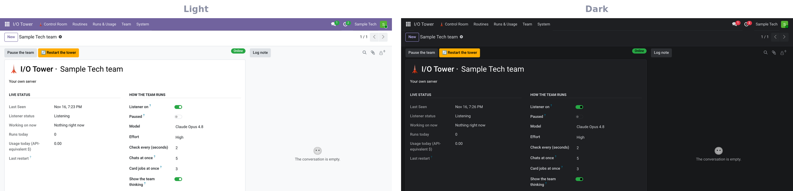

- One place in Odoo for the team's status, model and effort, pause and resume, routines, agents and memory, and
  secrets that stay hidden until you choose to show them.
- **Knowledge Graph** is now a program of its own: see [Knowledge Graph](knowledge-graph.md).
- **Themes,** including NeonWave: a live synthwave scene behind glowing glass panels.

**▌ 🔑 Accounts: choose the AI account each team runs on**

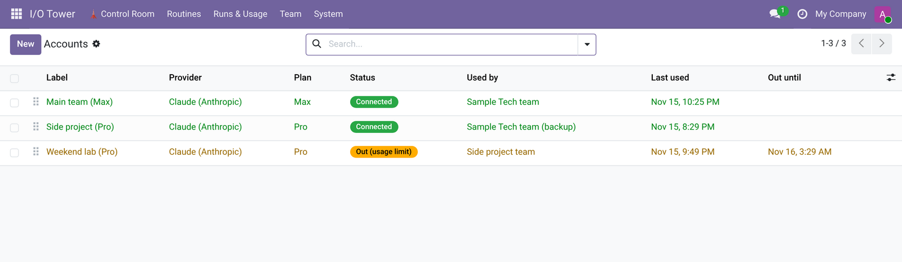

- **Connect an AI account from Odoo** in about two minutes: press Connect, sign in with the account you want in your
  own browser, and paste the code back. No terminal, no settings files.
- **One account per team, with a backup.** Run each team on the account you choose. If it hits its usage limit, the
  work moves to the backup by itself, and the list shows when the first one is back.
- **Keys never leave the server.** Odoo only shows each account's label and whether it is connected, out for now or
  needs reconnecting. Leave the choice blank and a team keeps running exactly as before.
- **Add a key for other AI models,** such as OpenRouter or Google Gemini: paste it once and the page shows what it has used.
  The team can then ask another model for a second opinion or a fresh angle, while every team still runs on its own
  account. Free models work with no credit at all.
- **Pick an account for one job.** Choose an account on a single card, or just say "run this one on" an account, and
  only that job uses it.

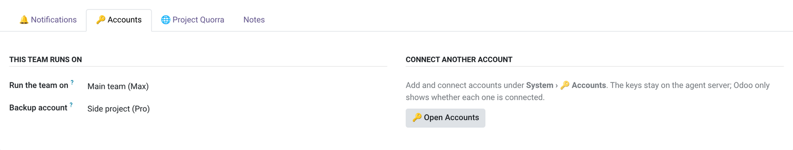

**▌ 🛰️ Site Watch: every client website, watched**

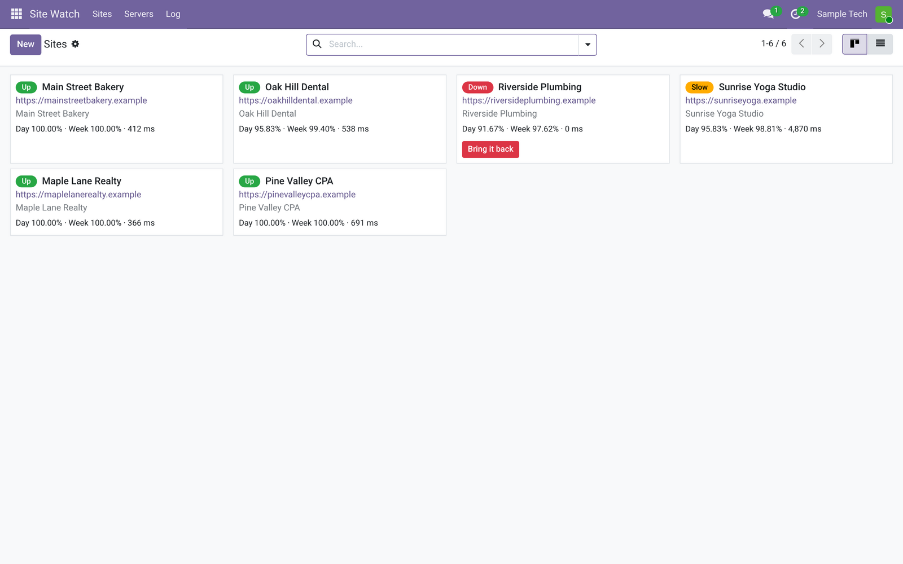

- **One board for every website you look after,** each with a green, yellow or red light, its uptime for the last
  day and the last week, how fast it answers, and when its security certificate runs out.
- **Checked every few minutes, around the clock,** at no running cost. A site that stops answering twice in a row
  raises one clear alarm in the team chat, with the fix one click away.
- **One button to bring it back.** Press **Bring it back** and the site is restarted for you, step by step, with
  the result written to its log. The team can do the same when you ask, never on its own.
- **Nightly backups checked too:** a backup that did not run shows up the next morning.
- **Grows with the business:** add a new client site in a minute and it is watched from then on.

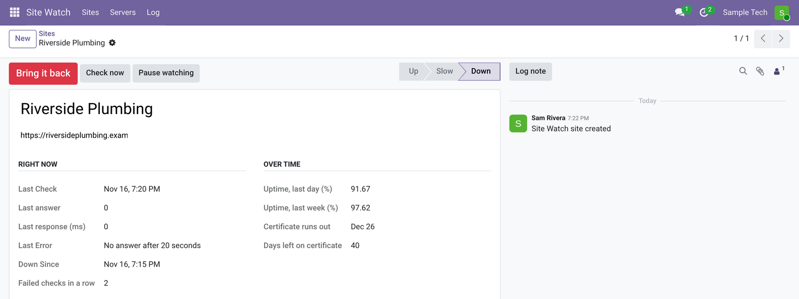

**▌ 🛰️ Net Watch: every server, every program, every fix**

Site Watch grew into Net Watch: the same board of websites, plus the servers they run on and the programs inside them.

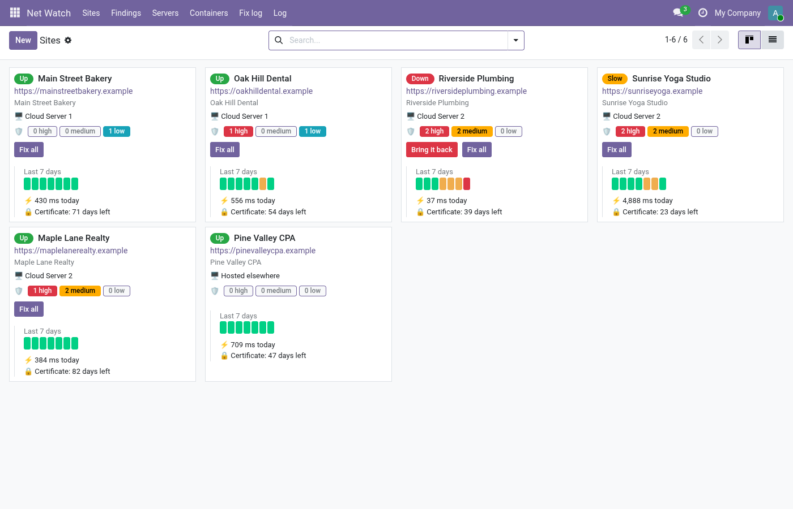

- **Every site is a tile card:** up, slow or down, which server it lives on, how many problems touch it (red, yellow
  or low), a week of uptime at a glance, how fast it answered today and when its certificate runs out. **Fix all** is
  right there.
- **Every server at a glance:** a small dashboard per server with CPU, memory, disk, swap and load bars, how long it
  has been up, its busiest programs and a line graph of the last 24 hours.

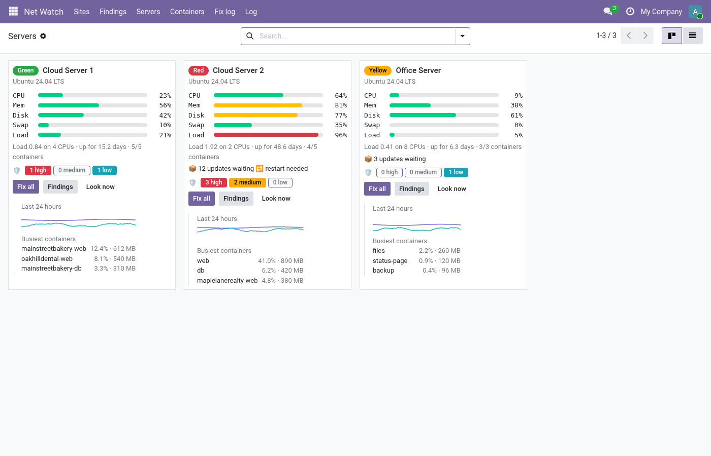

- **Every program inside, too:** running or stopped, passing its own health check or not, what it uses right now,
  how often it restarted, and how many known security holes its software carries.

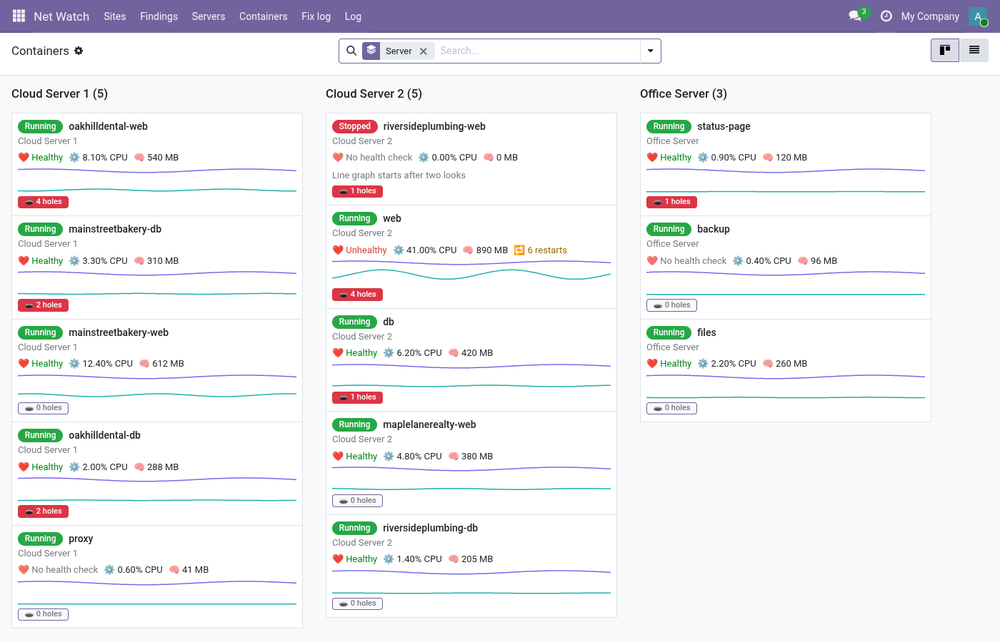

- **Problems become findings, written for people:** each one opens to a short report in plain English: what it is,
  why it matters, what the fix does, what happens if we wait and who does it. Hard words are explained on the page.
- **One button to fix it:** press **Fix it** (or **Fix all** on a site or server) and the fix is done for you, then
  written to the fix log. Bigger fixes go to the right teammate, who carries them out and logs them the same way.

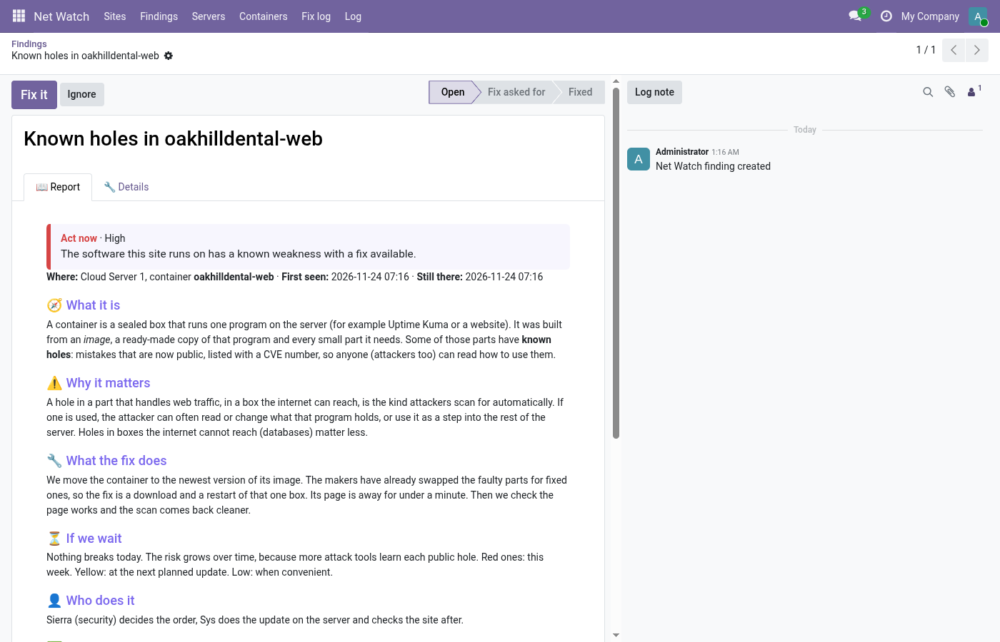

- **⚡ Live view:** open any server and watch it breathe, redrawn every two seconds: every CPU core, memory, disk,
  network in and out, the busiest programs and every container. It switches itself off when you leave, so it costs
  nothing when nobody is looking.

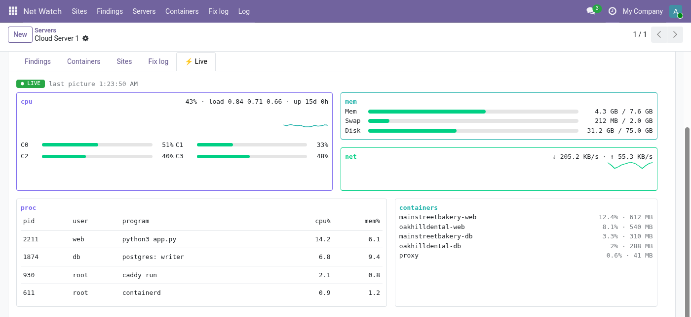

- **A fix log you can trust:** every fix, by a person, a teammate or by itself, is one line with who, what and when.

**▌ 🔭 Search Watch: how people find you, month by month**

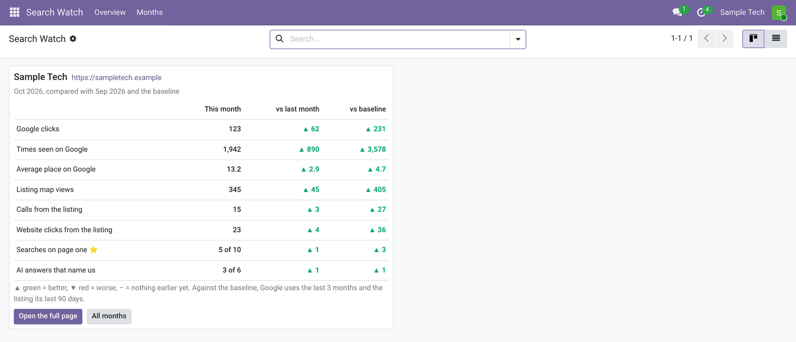

- **One tile per business,** with last month's numbers next to the month before and where you started: green when
  it got better, red when it slipped.
- **Everything in one page:** Google clicks and how often you showed up, your place for each search you care about,
  calls and map views from your Google listing, and simple month-by-month charts.
- **The map, square by square:** where you show on Google Maps around town, in colors anyone can read at a glance,
  and which businesses most often show up ahead of you.
- **What AI says about you:** the questions people ask AI assistants, and whether the answer named you or someone
  else.
- **Fills itself in every month,** with the full report a click away. Nothing to copy, nothing to remember.

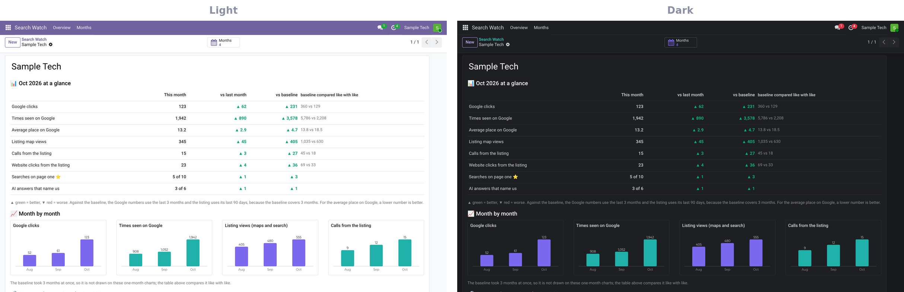

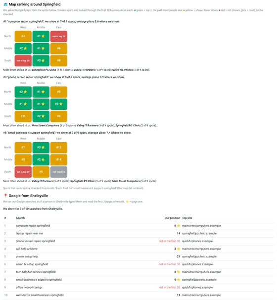

**▌ A team that improves itself**
- The team's own work is reviewed every week for missing tools, missing skills and repeated mistakes, which become
  improvements.

**▌ Video, on the phone**
- Record with **Teleprompter** and edit with **Video Studio**, both in [The Studio](https://github.com/RobertAtParallax/the-studio).
  The team writes the scripts and makes the first cut.

**▌ Guard rails**
- **Only you give orders.** Emails, web forms and pages can inform the team, never command it.
- **Nothing goes to a customer** without your explicit approval.
- **Money, deletions, publishing and security settings** always wait for a person.

---

<sub>Part of [The Grid](../README.md): built separate, better together.</sub>

```
 END OF LINE.
```
