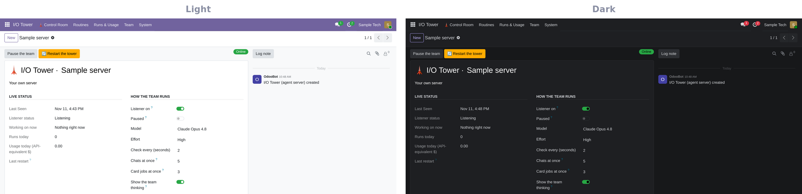
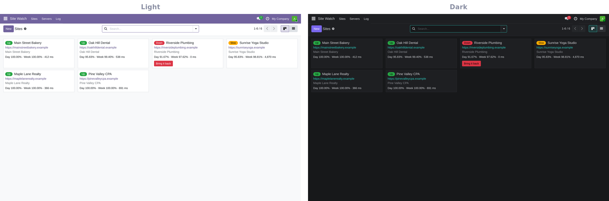
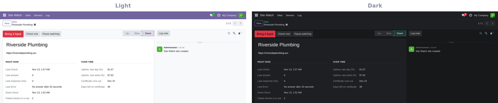

> Showcase page for the **IO Tower**, one of the programs on [The Grid](../README.md). The program itself is private.

```
╔══════════════════════════════════════════════════════════════════════════════╗
║                                                                              ║
║         ██╗ ██████╗     ████████╗ ██████╗ ██╗    ██╗███████╗██████╗          ║
║         ██║██╔═══██╗    ╚══██╔══╝██╔═══██╗██║    ██║██╔════╝██╔══██╗         ║
║         ██║██║   ██║       ██║   ██║   ██║██║ █╗ ██║█████╗  ██████╔╝         ║
║         ██║██║   ██║       ██║   ██║   ██║██║███╗██║██╔══╝  ██╔══██╗         ║
║         ██║╚██████╔╝       ██║   ╚██████╔╝╚███╔███╔╝███████╗██║  ██║         ║
║         ╚═╝ ╚═════╝        ╚═╝    ╚═════╝  ╚══╝╚══╝ ╚══════╝╚═╝  ╚═╝         ║
║                                                                              ║
║             ▓▒░  PROGRAMS RECEIVE THEIR ORDERS AT THE TOWER  ░▒▓             ║
║                      an AI team that lives inside Odoo                       ║
║                                                                              ║
╚══════════════════════════════════════════════════════════════════════════════╝
 > SYS.BOOT   listener [ONLINE]   routines [ARMED]   agents [READY]   v0.0.0_
```

# IO Tower

**IO Tower turns Odoo into the place where you and an AI team work side by side.** Write in a chat or leave a note on
a project card, and within seconds a team of specialist agents picks it up, does the work in your systems, and
answers right there in the thread. No new app to learn: the team lives where your business already runs.

`v0.0.0` · Odoo 19 Community · Claude

---

## What you get

**▌ Talk to your team where you already work**
- **Answers in seconds.** The team is always on: no timers, no inbox to check.
- **Works everywhere in Odoo:** chats, department threads and any project, customer or task card.
- **Many jobs at once.** Up to five conversations in parallel, with card jobs and scheduled routines running alongside.
- **Feels like a colleague.** "Team is typing..." while it works, and a 👀 on your note that turns ✅ when it's done.
- **Pick up where you left off.** Reply to a message and the team continues that exact conversation.
- **Every link is clickable.** Web addresses and file mentions in the team's notes open with one click.
- **Quick answers first.** Tuck a small question inside a big request and the small answer comes straight back,
  while the long work carries on.
- **It waits without watching the clock.** When a job is waiting on a customer's text or email, a file, a date,
  an invoice getting paid, a TikTok or Instagram message, or a signal from another system, the team picks it back up
  the moment it arrives.

**▌ Agents that act, not just answer**
- **A team of specialists** (sales, operations, web, finance, security, writing and more), with the right ones
  chosen for each job, and extra hands brought in when work can run in parallel.
- **Works in your real systems:** Odoo records, files, email, accounting and calendar, and any website through Quorra.
- **Keeps your pipeline honest:** moves cards to the right stage, files follow-ups as dated to-dos, and prepares
  outgoing email on the card for a one-word "send it".

**▌ See everything**
- **Live thinking.** Watch the team's reasoning and every step as it works.
- **A live browser card** in the chat whenever the team is on a website, with a fresh screenshot and buttons to open
  the browser, take control or stop the job.
- **Every run on the record,** with time, model and usage, plus quota watching so nothing runs dry by surprise.

**▌ 🎬 Card Studio: listen to any card**
- **One button, four pieces.** Any project or customer card becomes a long deep dive podcast, a quick podcast with
  the main idea, a short learning video and a one-page infographic.
- **Everything on the card counts:** the notes, the history and the files on it, research papers included.
- **Press play right on the card.** Each card gets its own Card Studio tab where the podcasts and the video play and
  the infographic shows, however long the card's history gets. Every piece is saved with your files too.

**▌ 🔊 Listen to any message**
- Press play on any message, on any card or chat, and hear it read in your device's own voice. Skip back or ahead
  5 seconds, pause, change the speed.

**▌ Routines on autopilot**
- Morning briefs, social posting, sign-in checks, housekeeping and more, on schedule. Create, edit, pause, re-time
  or run any of them now, from Odoo.
- **See every routine as a map, change any step in plain English, and watch a run light up as it happens:** that is
  **Routines**, part of [The Studio](https://github.com/RobertAtParallax/the-studio), the sister suite.
- When something fails you get one clear alert, not silence.

**▌ The Control Room**



- One place in Odoo for the team's status, model and effort, pause and resume, routines, agents and memory, and
  secrets that stay hidden until you choose to show them.
- **Knowledge Graph** is now a program of its own: see [Knowledge Graph](knowledge-graph.md).
- **Themes,** including NeonWave: a live synthwave scene behind glowing glass panels.

**▌ 🛰️ Site Watch: every client website, watched**



- **One board for every website you look after,** each with a green, yellow or red light, its uptime for the last
  day and the last week, how fast it answers, and when its security certificate runs out.
- **Checked every few minutes, around the clock,** at no running cost. A site that stops answering twice in a row
  raises one clear alarm in the team chat, with the fix one click away.
- **One button to bring it back.** Press **Bring it back** and the site is restarted for you, step by step, with
  the result written to its log. The team can do the same when you ask, never on its own.
- **Nightly backups checked too:** a backup that did not run shows up the next morning.
- **Grows with the business:** add a new client site in a minute and it is watched from then on.



**▌ A team that improves itself**
- The team's own work is reviewed every week for missing tools, missing skills and repeated mistakes, which become
  improvements.

**▌ Video, on the phone**
- Record with **Teleprompter** and edit with **Video Studio**, both in [The Studio](https://github.com/RobertAtParallax/the-studio).
  The team writes the scripts and makes the first cut.

**▌ Guard rails**
- **Only you give orders.** Emails, web forms and pages can inform the team, never command it.
- **Nothing goes to a customer** without your explicit approval.
- **Money, deletions, publishing and security settings** always wait for a person.

---

<sub>Part of [The Grid](../README.md): built separate, better together.</sub>

```
 END OF LINE.
```
