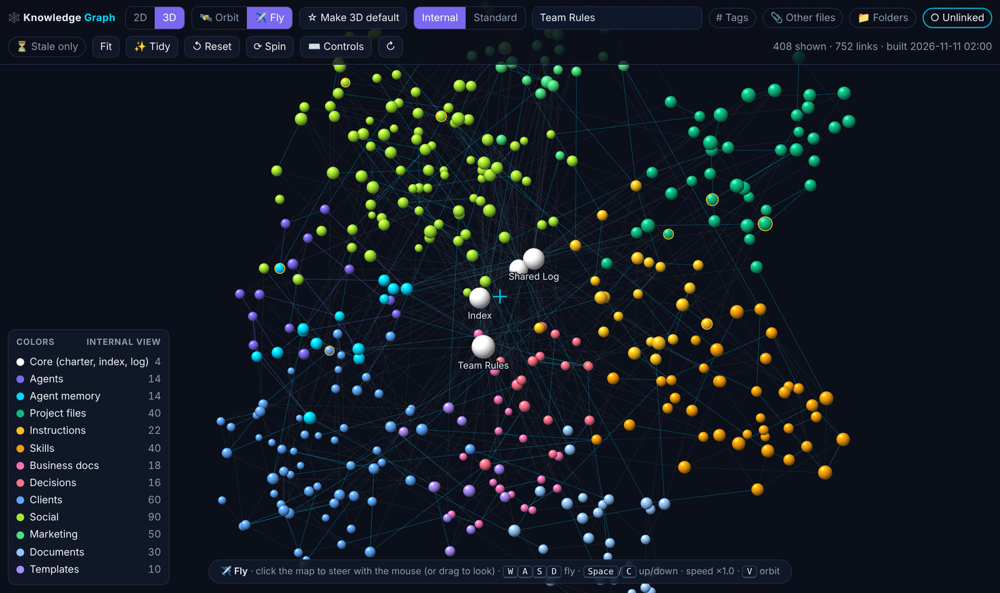
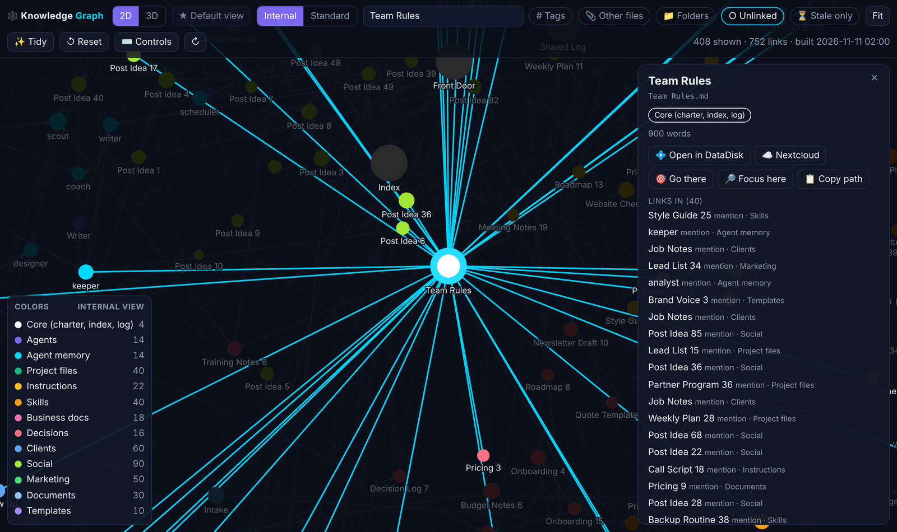
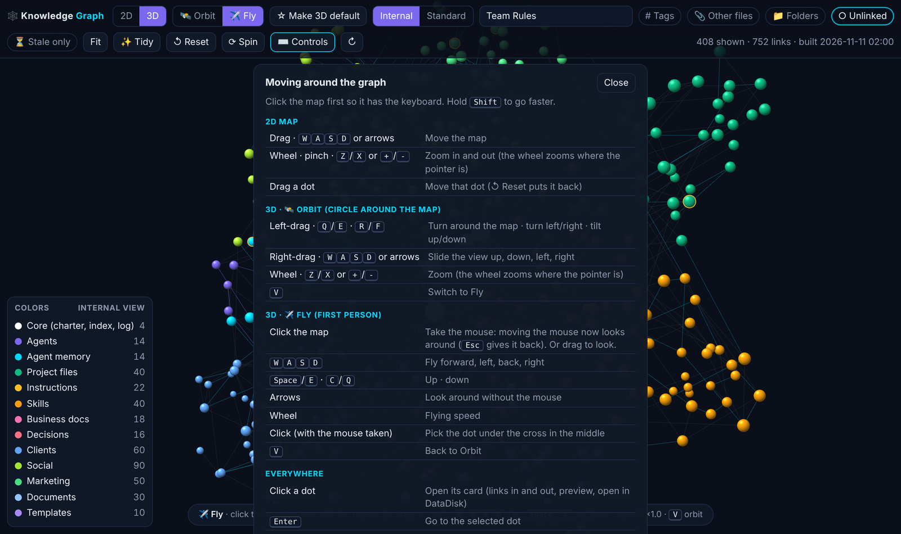

> Showcase page for **Knowledge Graph**, one of the programs on [The Grid](../README.md). The program itself is private.

```
╔══════════════════════════════════════════════════════════════════════════════╗
║                                                                              ║
║██╗  ██╗███╗   ██╗ ██████╗ ██╗    ██╗██╗     ███████╗██████╗  ██████╗ ███████╗║
║██║ ██╔╝████╗  ██║██╔═══██╗██║    ██║██║     ██╔════╝██╔══██╗██╔════╝ ██╔════╝║
║█████╔╝ ██╔██╗ ██║██║   ██║██║ █╗ ██║██║     █████╗  ██║  ██║██║  ███╗█████╗  ║
║██╔═██╗ ██║╚██╗██║██║   ██║██║███╗██║██║     ██╔══╝  ██║  ██║██║   ██║██╔══╝  ║
║██║  ██╗██║ ╚████║╚██████╔╝╚███╔███╔╝███████╗███████╗██████╔╝╚██████╔╝███████╗║
║╚═╝  ╚═╝╚═╝  ╚═══╝ ╚═════╝  ╚══╝╚══╝ ╚══════╝╚══════╝╚═════╝  ╚═════╝ ╚══════╝║
║                                                                              ║
║                   ██████╗ ██████╗  █████╗ ██████╗ ██╗  ██╗                   ║
║                  ██╔════╝ ██╔══██╗██╔══██╗██╔══██╗██║  ██║                   ║
║                  ██║  ███╗██████╔╝███████║██████╔╝███████║                   ║
║                  ██║   ██║██╔══██╗██╔══██║██╔═══╝ ██╔══██║                   ║
║                  ╚██████╔╝██║  ██║██║  ██║██║     ██║  ██║                   ║
║                   ╚═════╝ ╚═╝  ╚═╝╚═╝  ╚═╝╚═╝     ╚═╝  ╚═╝                   ║
║                                                                              ║
║              ▓▒░  EVERY FILE IS A STAR, EVERY LINK A ROUTE  ░▒▓              ║
║              your whole file share as a map you can fly through              ║
║                                                                              ║
╚══════════════════════════════════════════════════════════════════════════════╝
 > SYS.BOOT   map [LAID OUT]   filters [INSTANT]   flight [READY]   v0.1.0_
```

# Knowledge Graph

**Knowledge Graph shows every note, file, folder and tag in your share as one map.** Notes that link to each other,
files that mention each other, shared tags and folders become the lines between them. Look at it flat like a city
map, circle it in 3D, or drop into first person and fly through it with your mouse and keyboard. Click any dot to see
what it connects to and open it.

`v0.1.0` · any browser, or as an app in Odoo · mouse, keyboard and touch



---

## What you get

**▌ Three ways to explore**
- **A flat map:** drag to move, zoom where you point, names appear as you zoom in.
- **Orbit in 3D:** turn around the whole share, slide and zoom, or let it spin slowly.
- **Fly through it:** first person, like a game. Steer with the mouse, fly with the keyboard, go up and down, speed up.
  The name of the file in your sights shows as you go, and files you pass close to show their names.
- **Every move has a key,** and one button shows them all.

**▌ Fast, even on a big share**
- **Opens already arranged.** The map is worked out ahead of time on the server, so the page only has to draw it.
  A share with nearly 8,000 files opens in under a second.
- **Instant filters:** tags, other files, folders, unlinked notes, stale notes, any color group. They show or hide
  dots straight away and the map stays where it is, so you never lose your bearings.
- **Keeps its shape:** as files come and go, new ones appear next to their folder instead of the map reshuffling.

**▌ Every dot opens up**
- A card with what the file is, when it changed, its tags, a short preview, and every link in and out.
- **Open it** right there in the file manager, copy its path, fly to it, or focus on just it and its neighbors.
- **Search** any file, folder or tag.



**▌ Two views of the same share**
- **Internal** shows everything. **Standard** hides the system files a regular user never needs.

## Built separate. Better together.
On its own, Knowledge Graph maps any folder of notes and files on a server and shows it in a browser or inside Odoo.
With DataDisk, a file opens in a preview right on top of the map. With IO Tower, the team's own notes and memory are
part of the map, and keeping them linked keeps the map useful.



<sub>Screenshots use sample data.</sub>
