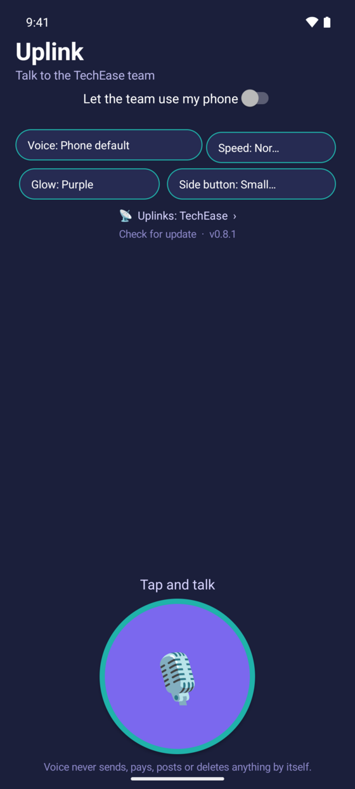
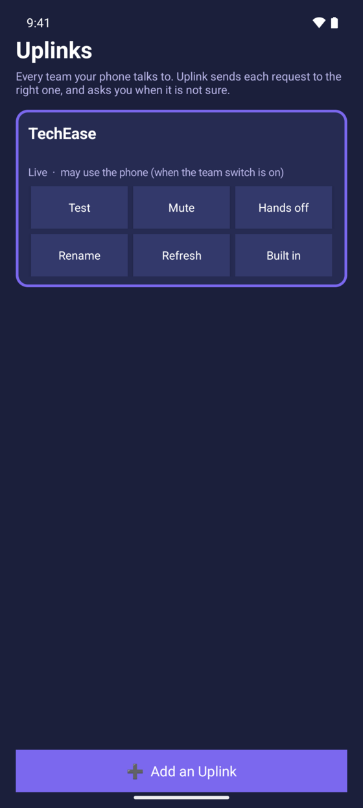

> Showcase page for **Uplink**, one of the programs on [The Grid](../README.md). The program itself is private.

```
╔══════════════════════════════════════════════════════════════════════════════╗
║                                                                              ║
║                ██╗   ██╗██████╗ ██╗     ██╗███╗   ██╗██╗  ██╗                ║
║                ██║   ██║██╔══██╗██║     ██║████╗  ██║██║ ██╔╝                ║
║                ██║   ██║██████╔╝██║     ██║██╔██╗ ██║█████╔╝                 ║
║                ██║   ██║██╔═══╝ ██║     ██║██║╚██╗██║██╔═██╗                 ║
║                ╚██████╔╝██║     ███████╗██║██║ ╚████║██║  ██╗                ║
║                 ╚═════╝ ╚═╝     ╚══════╝╚═╝╚═╝  ╚═══╝╚═╝  ╚═╝                ║
║                                                                              ║
║                      ▓▒░  THE TOWER IN YOUR POCKET  ░▒▓                      ║
║               a phone assistant that gives your AI team hands                ║
║                                                                              ║
╚══════════════════════════════════════════════════════════════════════════════╝
 > SYS.BOOT   voice [LISTENING]   hands [STANDBY]   guard rails [ARMED]   v0.5.0_
```

# Uplink

**Uplink puts an AI team in your pocket.** Hold the side button and talk: quick answers come back out loud in
seconds, bigger jobs go to the whole team and the answer is read to you when it is ready. And when you say so, the
team can use the phone for you, while you watch.

`v0.8.1` · Android phones · a native app, no rooting or tinkering

<p></p>

---

## What you get

**▌ An assistant on the side button**
- **Takes the place of the built-in assistant.** Hold the side button and talk, from any screen.
- **A small panel, not a takeover.** It slides up over the app you are in, and that app stays usable underneath.
- **Quick answers in seconds,** spoken out loud.
- **Big jobs go to the whole team,** and the answer is read to you when it lands, even after you have moved on.
- **One-tap call, text and directions,** with the number looked up for you.
- **Your choice of voice and speed,** and it pauses your music while it talks.

**▌ One app for every team in your life**
- **Talk to all of them from one place:** your business team, your family's team, and more as you add them.
- **It works out who you mean.** Say a name ("tell the family...") or just talk: it knows which team knows which
  people, and keeps a conversation with the team you are talking to.
- **It keeps up by itself.** Each team's list of people stays current on its own, so a new client or a nickname like
  "Kristen's site" goes to the right team without you touching a setting.
- **It asks instead of guessing.** Not sure? It asks one short question ("Is this for work or the family?") before
  your words go anywhere.
- **Answers say who they are from,** out loud and on screen.
- **You keep the list:** add a team with one tap from its link, mute one, rename it, or remove it. A new team can
  talk to you but cannot use your phone until you allow it.
- **Each team keeps its own walls.** Uplink only passes your words to the team they are for; nothing is copied
  between teams.

<p></p>

<sub>Screenshots: Uplink on a sample phone, with no accounts on it. The app has one look, so there is no separate Light and Dark pair.</sub>

**▌ The team's hands on your phone** (only while you allow it)
- **Opens the real apps** you already use, reads the screen, and taps, types, scrolls and swipes.
- **Checks every step landed** before the next, so a multi-step job gets finished, not abandoned halfway.
- **Sees the actual picture** when words are not enough: a video, a photo, a chart.
- **Hands you files:** a video the team made shows up in your Gallery, ready to post.
- **Puts text on your clipboard,** ready to paste.
- **Alarms, timers, flashlight, volume and Do Not Disturb,** and a buzz when something needs you.

**▌ You stay in charge**
- **Off until you turn it on,** with a one-swipe switch in your quick settings.
- **Your Yes for anything that reaches people or money.** Calls, texts, and anything that sends, posts, pays or
  deletes waits on the phone until you tap Yes.
- **You can see it working:** the edge of the screen glows while the team is using the phone.
- **Every step is logged,** so nothing happens out of sight.
- **It only talks to your own server,** over your private network.

**▌ Easy to keep current**
- **Updates in place** with one tap. No uninstalling, no setting it up again.

---

## Built separate, better together

Uplink is its own app. With the IO Tower it is the team's voice and hands on your phone: the same team, the same
memory, the same guard rails. On its own (on the way) it becomes a very capable phone assistant by itself.

---

<sub>Part of [The Grid](../README.md): built separate, better together.</sub>

```
 END OF LINE.
```
